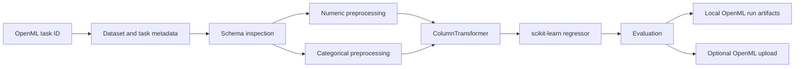

# OpenML Regression Bot

### Automated scikit-learn regression experiments for OpenML tasks

> [!IMPORTANT]
> This is a public documentation and results showcase. The current implementation source is intentionally withheld because it contains confidential material. Public run artifacts are retained to demonstrate the project workflow and output structure.

## Overview

The OpenML Regression Bot was developed as an academic automation tool for running configurable scikit-learn regression pipelines on OpenML tasks. It handled dataset retrieval, mixed-type preprocessing, model configuration, hyperparameter evaluation, local result storage, and optional publication of completed runs to OpenML.

The goal was to reduce repetitive experiment setup and provide a consistent path from an OpenML task identifier to an auditable regression run.

## Features

- OpenML regression-task retrieval by task ID
- Command-line experiment configuration
- Numerical and categorical preprocessing with `ColumnTransformer`
- scikit-learn pipeline construction
- ConfigSpace-based hyperparameter definitions
- Default-configuration and tuned experiment modes
- Local run-artifact generation
- Optional upload of completed runs to OpenML
- Reusable model, flow, prediction, and description artifacts

## Architecture



## Public Repository Contents

```text
.
├── myrun/
│   ├── description.xml    # Run description metadata
│   ├── flow.xml           # Serialized OpenML flow description
│   ├── model.pkl          # Historical serialized model artifact
│   └── predictions.arff   # Stored predictions
├── requirements.txt       # Historical dependency versions
└── README.md
```

Generated cache directories may also be visible in older repository revisions; they are not part of the application design.

## Setup

The public repository is not distributed as a runnable package because the implementation is confidential. The dependency file records the historical stack used during development:

- NumPy 1.21.5
- OpenML-Python 0.12.2
- scikit-learn 0.21.0
- ConfigSpace 0.4.19

These versions are retained for technical context and may require an older compatible Python environment. Authorized users should follow the private setup documentation rather than treating the public `requirements.txt` as a currently supported installer.

## Usage

The original private CLI accepted inputs conceptually equivalent to:

- OpenML task ID
- OpenML server address
- OpenML API key
- Regressor name
- Whether results should be uploaded
- Whether the default configuration should be used

The automated workflow then retrieved the task, built the preprocessing/model pipeline, executed the run, evaluated it, and stored or uploaded the result.

No public executable command is provided because the source implementation is intentionally excluded.

## Results

The `myrun/` directory demonstrates the artifacts produced by a completed OpenML-compatible experiment:

| Artifact | Purpose |
| --- | --- |
| `description.xml` | Run configuration and metadata |
| `flow.xml` | Machine-learning flow definition |
| `predictions.arff` | Per-sample predictions and evaluation data |
| `model.pkl` | Serialized historical estimator |

Detailed task-specific performance claims are not reproduced in this public summary because the matching private configuration and implementation are not distributed.

## Technology Stack

| Area | Technology |
| --- | --- |
| Language | Python |
| Experiment platform | OpenML |
| Machine learning | scikit-learn |
| Hyperparameter definitions | ConfigSpace |
| Numerical processing | NumPy |
| Result formats | OpenML XML, ARFF, pickle |

## Limitations

- The source implementation is confidential and is not publicly reproducible.
- The historical dependency versions are old and may not install on current Python releases.
- The project targets regression tasks only.
- The original implementation supports scikit-learn rather than multiple ML frameworks.
- Experiments depend on OpenML availability, task quality, and API compatibility.
- Public run artifacts do not by themselves provide the complete experiment configuration.
- Never load an untrusted `.pkl` file; Python pickle deserialization can execute arbitrary code.
- API keys must never be committed to a repository or included in command history shared publicly.

## Confidentiality Notice

This repository documents project scope and publicly shareable outputs only. The implementation, internal configurations, and any restricted experimental material remain private.
